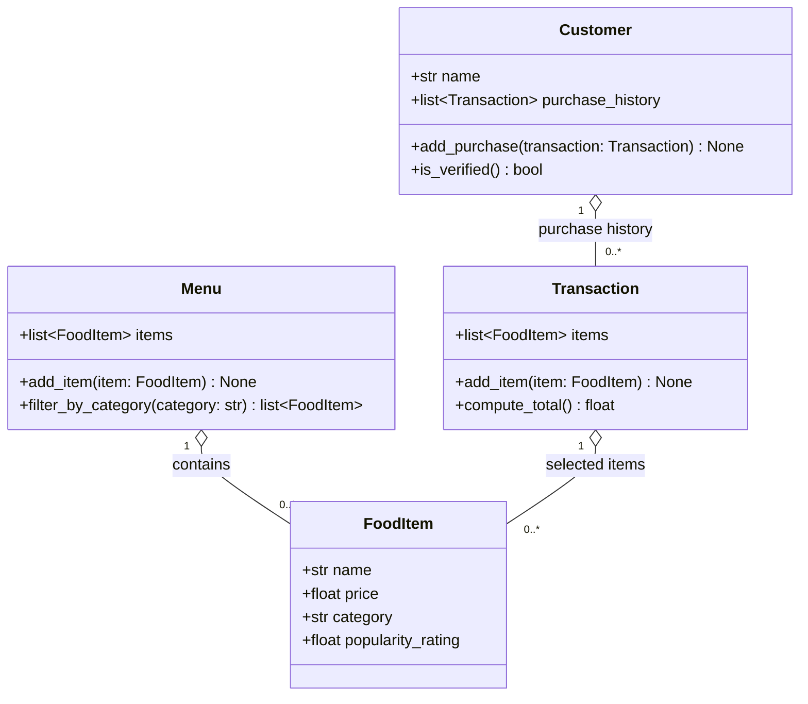

# ByteBites UML Class Diagram

## Requirements Stated by the Client

- **Customer:** tracks name and past purchase history so the system can verify they are real users.
- **FoodItem:** tracks name, price, category, and popularity rating.
- **Menu:** holds all items and filters them by category (e.g., "Drinks", "Desserts").
- **Transaction:** stores the selected items and computes the total cost.

## Design Assumptions

1. **Verification rule (assumption):** The feature request does not define how verification works. `is_verified()` assumes a customer is verified if their `purchase_history` contains at least one transaction.
2. **Helper methods (assumption):** `add_purchase()`, `Menu.add_item()`, and `Transaction.add_item()` are not named in the request. They are the minimal way to populate each list.
3. **No back-reference (assumption):** `Transaction` does not store its `Customer`; the request only requires it to hold items and compute a total. The link is kept through `Customer.purchase_history`.
4. **Multiplicity (assumption):** A `Transaction` holds `0..*` items because it starts empty and is filled as items are picked. The request does not state whether an empty transaction is allowed.

## Relationships

Hollow diamonds (`o--`) indicate aggregation: a `FoodItem` exists independently and can appear on the `Menu` and in many `Transaction`s at once.
